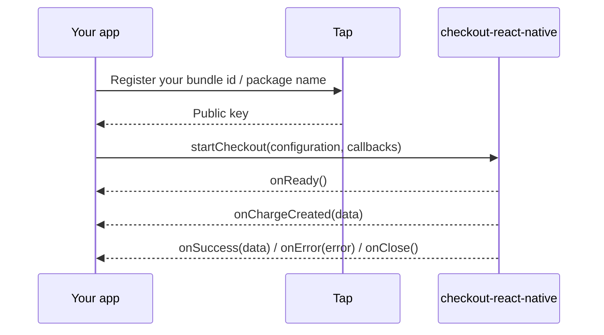

# checkout-react-native

Tap Payments' React Native checkout SDK. Present a full Tap checkout from your app, collect a card or local payment method, and get the result back through a few callbacks. It wraps the native [Checkout-IOS](https://github.com/Tap-Payments/Checkout-IOS) and [Checkout-Android](https://github.com/Tap-Payments/Checkout-Android) SDKs.


- [Requirements](#requirements)
- [How it works](#how-it-works)
- [Installation](#installation)
- [Platform setup](#platform-setup)
- [Quick start](#quick-start)
- [Callbacks](#callbacks)
- [Configuration reference](#configuration-reference)
- [Charge vs Authorize](#charge-vs-authorize)
- [Sandbox vs production](#sandbox-vs-production)
- [Example app](#example-app)
- [Tests](#tests)
- [Troubleshooting](#troubleshooting)

## Requirements

| | iOS | Android |
|---|---|---|
| React Native | New Architecture (TurboModule; the default since 0.76) | New Architecture (TurboModule; the default since 0.76) |
| Native SDK | `Checkout-IOS` 1.0.7 | `com.github.Tap-Payments:Checkout-Android:1.0.9` (JitPack) |
| Minimum OS | React Native's minimum (`min_ios_version_supported`) | API 24 (Android 7.0) |
| Xcode | Latest stable; 16.3+ when using [Swift Package Manager](#ios-swift-package-manager) | |

## How it works



## Installation

```sh
npm install checkout-react-native
# or
yarn add checkout-react-native
```

The module is autolinked on both platforms.

### iOS: CocoaPods (default)

```sh
cd ios && pod install
```

The pod depends on `Checkout-IOS` 1.0.7. Open the generated `.xcworkspace`, not the `.xcodeproj`.

> [!TIP]
> Some transitive pods of `Checkout-IOS` declare a deployment target below what current Xcode accepts. If the build fails with an `IPHONEOS_DEPLOYMENT_TARGET` error, raise them in the `post_install` hook of your Podfile:
>
> ```ruby
> post_install do |installer|
>   react_native_post_install(installer, config[:reactNativePath])
>
>   installer.pods_project.targets.each do |target|
>     target.build_configurations.each do |config|
>       current = config.build_settings['IPHONEOS_DEPLOYMENT_TARGET']
>       if current && Gem::Version.new(current) < Gem::Version.new(min_ios_version_supported)
>         config.build_settings['IPHONEOS_DEPLOYMENT_TARGET'] = min_ios_version_supported
>       end
>     end
>   end
> end
> ```

### iOS: Swift Package Manager

To take `Checkout-IOS` from its Swift package instead of the pod, set `CHECKOUT_IOS_SPM`:

```sh
cd ios && CHECKOUT_IOS_SPM=1 pod install
```

The wrapper's podspec then uses React Native's `spm_dependency` to add the `Checkout-IOS` product of `https://github.com/Tap-Payments/Checkout-IOS.git` (exact version 1.0.7) to the Pods project. React Native itself still comes from CocoaPods.

- The variable is read on every `pod install`. To avoid forgetting it, set it at the top of your Podfile:

  ```ruby
  ENV['CHECKOUT_IOS_SPM'] = '1'
  ```

- Switching between CocoaPods and SPM needs a fresh `pod install`.
- Requires Xcode 16.3 or later (the package uses `swift-tools-version` 6.1).

### Android

The native SDK is published on [JitPack](https://jitpack.io/#Tap-Payments/Checkout-Android). Add the repository to your app's repositories, in `android/settings.gradle` (`dependencyResolutionManagement`) or `android/build.gradle` (`allprojects`):

```groovy
repositories {
    google()
    mavenCentral()
    maven { url 'https://jitpack.io' }
}
```

> [!NOTE]
> The Tap SDK's manifest sets `android:usesCleartextTraffic="true"`. If your app manifest sets that attribute too, add `tools:replace="android:usesCleartextTraffic"` on `<application>` or the manifest merge fails.

### Expo

The package has native code, so it runs in a [development build](https://docs.expo.dev/develop/development-builds/introduction/) (`npx expo run:ios` / `run:android`, or EAS Build), not in Expo Go. Install it and add its config plugin to `app.json`:

```sh
npx expo install checkout-react-native
```

```json
{
  "expo": {
    "plugins": [
      ["checkout-react-native", { "cameraPermission": "Used to scan your card." }]
    ]
  }
}
```

The plugin adds the JitPack repository on Android and, with `cameraPermission`, the iOS camera usage description. Options:

| Option | Effect |
|---|---|
| `cameraPermission` | Sets `NSCameraUsageDescription` (needed for the card scanner). |
| `ios.spm` | `true` takes `Checkout-IOS` from Swift Package Manager instead of CocoaPods (see [iOS: Swift Package Manager](#ios-swift-package-manager)). |

Run `npx expo prebuild --clean` after changing the plugin options.

## Platform setup

### iOS: Info.plist

Add a camera usage description to your app's `ios/<App>/Info.plist`. It is required by the card scanner; without it iOS terminates the app when the scanner opens.

```xml
<key>NSCameraUsageDescription</key>
<string>Used to scan your card.</string>
```

Apple Pay needs the *Apple Pay* capability and a merchant identifier on your app target.

### Android: permissions

The SDK's manifest already declares what it needs, and it is merged into your app's `AndroidManifest.xml` automatically:

| Permission | Used for |
|---|---|
| `INTERNET`, `ACCESS_WIFI_STATE` | Loading the checkout |
| `CAMERA` | The card scanner. The SDK asks for it at runtime when the scanner opens. |
| `NFC` | Reading a card with NFC (`cardOptions.alternativeCardInputs.cardNFC`) |

## Quick start

1. Build a configuration object.
2. Implement `CheckoutCallbacks`.
3. Call `startCheckout(configuration, callbacks)`.

```tsx
import { startCheckout } from 'checkout-react-native';
import type { CheckoutCallbacks } from 'checkout-react-native';

const callbacks: CheckoutCallbacks = {
  onReady: () => {},
  onChargeCreated: (data) => console.log('charge created:', data),
  onSuccess: (data) => console.log('success:', data),
  onError: (error) => console.log('error:', error),
  onClose: () => {},
};

export function pay() {
  startCheckout(
    {
      gateway: { publicKey: 'pk_test_YOUR_PUBLIC_KEY' },
      language: 'en',
      themeMode: 'light',
      paymentType: 'ALL',
      supportedPaymentMethods: 'ALL',
      supportedCurrencies: 'ALL',
      selectedCurrency: 'KWD',
      amount: 5,
      customer: {
        firstName: 'Jane',
        lastName: 'Doe',
        email: 'jane@example.com',
        phone: { countryCode: '965', number: '55567890' },
      },
      order: {
        currency: 'KWD',
        amount: 5,
        items: [
          { name: 'Item', description: 'Item description',
            quantity: 1, amount: 5, currency: 'KWD' },
        ],
      },
      transaction: {
        mode: 'charge',
        charge: {
          saveCard: true,
          threeDSecure: true,
          redirect: { url: 'https://example.com/checkout/return' },
        },
      },
    },
    callbacks
  );
}
```

```ts
startCheckout(configuration: Record<string, any>, callbacks: CheckoutCallbacks): void
```

On iOS the checkout sheet is presented from the top-most view controller; on Android the wrapper adds a full-screen checkout view to the current activity and removes it when the flow ends. You do not add any view yourself.

> [!NOTE]
> `startCheckout` does not validate the configuration. Invalid or missing values are reported by the Tap backend inside the checkout or through `onError`.

## Callbacks

`onReady`, `onSuccess`, `onError` and `onClose` are required; `onChargeCreated` is optional. `data` / `error` is a **JSON string** produced by the checkout; parse it with `JSON.parse`. `onReady`, `onSuccess`, `onError` and `onClose` fire at most once per `startCheckout` call. `onChargeCreated` fires for every charge the checkout creates, so it can fire more than once, for example when the customer comes back from KNET or another redirect and pays again. It keeps listening until the next `startCheckout` call: on Android, going back from KNET reports `onClose` and then shows the checkout again, where the customer can still pay.

| Callback | Fires when | Argument | Checkout dismissed | iOS (`CheckoutSDKDelegate`) | Android (`TapCheckoutStatusDelegate`) |
|---|---|---|---|---|---|
| `onReady()` | The checkout page finished loading and is ready for input. | none | No | `onReady()` | `onCheckoutReady()` |
| `onChargeCreated?(data)` | A charge/authorization object was created, before the checkout completes. | JSON string | No | `onChargeCreated(data:)` | `onCheckoutChargeCreated(data)` |
| `onSuccess(data)` | The checkout completed, including after a 3D Secure challenge. | JSON string (after 3DS: the charge id) | Yes | `onSuccess(data:)` | `onCheckoutSuccess(data)` |
| `onError(error)` | The checkout failed, a network step failed, or (iOS) the camera permission was denied. | JSON string (some native errors are plain text) | Yes | `onError(data:)` | `onCheckoutError(error)` |
| `onClose()` | The user closed the checkout. | none | Yes | `onClose()` | `onCheckoutcancel()` |

> [!TIP]
> Treat `onSuccess` as "the flow finished". After 3D Secure its payload is `{"chargeId":"chg_..."}`; confirm the final payment status on your server with the Retrieve Charge API ([Charges reference](https://developers.tap.company/reference/charges)) (`GET /v2/charges/{charge_id}`).

## Configuration reference

The configuration is a plain object, the same dictionary the native SDKs take, and it mirrors the Tap web checkout demo. Dotted paths mean nested objects (`gateway.publicKey` is `{ gateway: { publicKey: ... } }`). Defaults are the values the example app sends, which match the web demo; "omit" means the key is not sent. Everything except `gateway.publicKey`, `language` and `themeMode` is forwarded to the Tap backend.

[`example/src/CheckoutSettings.ts`](example/src/CheckoutSettings.ts) builds this object from the example app's settings (`makeConfiguration`), the same way the native example apps and the web demo do.

### SDK and gateway

| Key | Type | Values | Default |
|---|---|---|---|
| `gateway.publicKey` | string | Your Tap public key (`pk_test_...` / `pk_live_...`). Required. | none |
| `gateway.merchantId` | string | Merchant id associated with the key | omit |
| `hashString` | string | Hash generated on your server (see [Sandbox vs production](#sandbox-vs-production)) | `""` |
| `language` | string | `en`, `ar`, or `dynamic` (Android only: replaced with the device language) | `en` |
| `themeMode` | string | `light`, `dark`, `light_mono`, `dark_colored`, or `dynamic` (Android only: replaced with the device's light/dark mode) | `light` |
| `checkoutMode` | string | Android only: `popup` (bottom sheet), `page` (full screen) | `page` (set by the wrapper when omitted) |
| `paymentType` | string | `ALL`, `WEB`, `CARD`, `DEVICE` | `ALL` |
| `supportedPaymentMethods` | string or string[] | `"ALL"` or any of `AMERICAN_EXPRESS`, `APPLE_PAY`, `BENEFIT`, `BENEFITPAY`, `CAREEMPAY`, `FAWRY`, `GOOGLE_PAY`, `KNET`, `MADA`, `MASTERCARD`, `MEEZA`, `OMANNET`, `PAYPAL`, `POST_PAY`, `NAPS`, `STC_PAY`, `TABBY`, `VISA` | `"ALL"` |
| `selectedCurrency` | string | `KWD`, `BHD`, `SAR`, `AED`, `OMR`, `EGP`, `GBP`, `USD`, `EUR` | `SAR` |
| `supportedCurrencies` | string or string[] | `"ALL"`, `"AUTO"`, or a list of currency codes | `"ALL"` |
| `supportedRegions` | string[] | `LOCAL`, `REGIONAL`, `GLOBAL` | omit |
| `supportedCountries` | string[] | ISO alpha-2 country codes | omit |
| `supportedPaymentTypes` | string[] | `CARD`, `DEVICE_WALLET`, `EXPRESS_CHECKOUT_WALLET`, `PASS_THRU_WALLET`, `STORED_VALUE_WALLET`, `CASH_WALLET`, `BNPL` | omit |
| `supportedSchemes` | string[] | `BENEFIT`, `VISA`, `AMEX`, `MASTERCARD`, `MADA`, `MEEZA`, `OMANNET` | omit |
| `isApplePayAvailableOnClient` | boolean | iOS. On Android the wrapper always sends `false`. | `true` |
| `open` | boolean | Always `true` (the web SDK adds it too; on Android the wrapper sets it) | `true` |

### Customer

| Key | Type | Notes |
|---|---|---|
| `customer.id` | string | Existing Tap customer id. Omit if empty. |
| `customer.firstName` | string | Required. |
| `customer.lastName` | string | Required unless `customer.id` is set. |
| `customer.email` | string | |
| `customer.phone.countryCode` | string | For example `965`. |
| `customer.phone.number` | string | Digits and `+`, at least 8 characters. |

### Card options

| Key | Type | Values | Default |
|---|---|---|---|
| `cardOptions.showBrands` | boolean | | `true` |
| `cardOptions.showLoadingState` | boolean | | `false` |
| `cardOptions.collectHolderName` | boolean | | `true` |
| `cardOptions.preLoadCardName` | string | Pre-filled card holder name | `""` |
| `cardOptions.cardNameEditable` | boolean | | `true` |
| `cardOptions.cardFundingSource` | string | `all`, `credit`, `debit` | `all` |
| `cardOptions.saveCardOption` | string | `all`, `merchant`, `tap`, `none` | `all` |
| `cardOptions.forceLtr` | boolean | | `false` |
| `cardOptions.alternativeCardInputs.cardScanner` | boolean | Shows the native card scanner button. iOS needs `NSCameraUsageDescription`. | omit |
| `cardOptions.alternativeCardInputs.cardNFC` | boolean | Shows the NFC card reader button. Android only; the iOS SDK always forces it to `false`. | omit |

### Order

| Key | Type | Notes |
|---|---|---|
| `amount` | number | Order total: sum of `amount * quantity` over items, minus the discount. Must be greater than 0. |
| `order.id` | string | Your order reference. Default `""`. |
| `order.currency` | string | Same as `selectedCurrency`. |
| `order.amount` | number | Same value as top-level `amount`. |
| `order.items[]` | array | At least one item. |
| `order.items[].name` | string | Min 2 characters. |
| `order.items[].description` | string | Min 2 characters. |
| `order.items[].quantity` | number | Required. |
| `order.items[].amount` | number | `>= 0`. |
| `order.items[].currency` | string | Same as `selectedCurrency`. |
| `order.discount.type` | string | `F` (fixed) or `P` (percentage). Send only when the value is greater than 0. |
| `order.discount.value` | number | Discount value. |

### Transaction

| Key | Type | Values | Default |
|---|---|---|---|
| `transaction.mode` | string | `charge`, `authorize` | `charge` |
| `transaction.<mode>.threeDSecure` | boolean | | `true` |
| `transaction.<mode>.saveCard` | boolean | | `true` |
| `transaction.<mode>.redirect.url` | string | URL the 3D Secure / redirect flow returns to | none |
| `transaction.<mode>.auto.type` | string | `CAPTURE`, `VOID` (see [Charge vs Authorize](#charge-vs-authorize)) | `VOID` |
| `transaction.<mode>.auto.time` | number | Hours before the automatic action | `100` |
| `transaction.<mode>.agreement.type` | string | `SCHEDULED`, `UNSCHEDULED` (recurring / saved agreements) | omit |
| `transaction.<mode>.agreement.amount_variability` | string | `FIXED`, `VARIABLE` (scheduled only) | `FIXED` |
| `transaction.<mode>.subscription.type` | string | `SCHEDULED` (not sent when the agreement type is `UNSCHEDULED`) | `SCHEDULED` |
| `transaction.<mode>.subscription.amount_variability` | string | `FIXED`, `VARIABLE` | `FIXED` |
| `transaction.<mode>.subscription.txn_count` | number | Number of payments; `0` means undefined | `0` |
| `transaction.<mode>.airline.reference.booking` | string | Airline booking reference. `airline` is sent by default; leave it out to disable it. | `""` |

`<mode>` is the value of `transaction.mode`.

## Charge vs Authorize

`transaction.mode` decides what the checkout creates:

- `charge`: payment is captured immediately.
- `authorize`: funds are reserved and captured or voided later.

The settings for the transaction live in a sub-object **named after the mode**: `transaction.charge` for charges, `transaction.authorize` for authorizations. The inner fields are identical; only the key name changes. Use exactly one.

For authorizations, `auto` controls what happens if you do nothing:

- `auto.type`: `CAPTURE` captures the authorization automatically, `VOID` releases it.
- `auto.time`: hours to wait before that automatic action is applied (`100` in the web demo).

**Charge**

```json
{
  "transaction": {
    "mode": "charge",
    "charge": {
      "saveCard": true,
      "threeDSecure": true,
      "redirect": { "url": "https://example.com/checkout/return" }
    }
  }
}
```

**Authorize**

```json
{
  "transaction": {
    "mode": "authorize",
    "authorize": {
      "saveCard": true,
      "threeDSecure": true,
      "auto": { "type": "VOID", "time": 100 },
      "redirect": { "url": "https://example.com/checkout/return" }
    }
  }
}
```

The SDK itself handles both modes the same way and fires the same callbacks. To capture or void an authorization manually, call the Tap API **from your server** using the authorization id returned in the callback payload. See [developers.tap.company](https://developers.tap.company).

## Sandbox vs production

| | Sandbox | Production |
|---|---|---|
| Public key | `pk_test_...` | `pk_live_...` |
| Money moves | No | Yes |

- Switch environments by changing `gateway.publicKey`. The Tap backend picks sandbox or production from the key.
- Use only your **public** key in the app. Never embed a secret key (`sk_...`) in a JS bundle or mobile binary; it can be extracted.
- `hashString` must be generated on **your server** and passed to the app. Follow the [Tap documentation](https://developers.tap.company) for how to compute it; do not compute it with a secret key on the device.
- Keep keys out of source control: load them from build configuration or a remote config, not hard-coded literals in committed files.

## Example app

The repository has one example app, with the same screens as the native example apps, built with the React Native CLI and with Expo, on iOS through CocoaPods or Swift Package Manager:

```sh
yarn                 # once, at the repository root
yarn ios:pods        # or ios:spm, android, expo:ios:pods, expo:ios:spm, expo:android
```

How to run every variant and add your sandbox keys is in [example/README.md](example/README.md).

## Tests

```sh
yarn test
```

runs the library's Jest tests and the example app's. The UI tests against the Tap sandbox are described in [example/README.md](example/README.md#tests).

## Troubleshooting

| Problem | Fix |
|---|---|
| iOS build fails with an `IPHONEOS_DEPLOYMENT_TARGET` error | Add the `post_install` hook from [Installation](#ios-cocoapods-default). |
| SPM: Xcode can't resolve `Checkout-IOS` or the package fails to build | Use Xcode 16.3 or later, and run `pod install` again with `CHECKOUT_IOS_SPM=1` set. |
| `Checkout-IOS` still comes from CocoaPods (or SPM) after switching | `CHECKOUT_IOS_SPM` is read on every `pod install`; set it in the Podfile and run `pod install` again. |
| Android: `Could not find com.github.Tap-Payments:Checkout-Android` | Add `maven { url 'https://jitpack.io' }` to your repositories and make sure JitPack is reachable from your network. |
| Android manifest merge fails on `android:usesCleartextTraffic` | Add `tools:replace="android:usesCleartextTraffic"` on `<application>`. |
| App crashes when tapping the card scanner (iOS) | Add `NSCameraUsageDescription` to Info.plist. |
| Camera permission denied | iOS: the checkout closes and `onError` fires with `{"error":"The user didn't approve accessing the camera."}`. Android: the scanner cannot open. Ask the user to allow the camera in the system settings. |
| Android: `onError` fires with `INVALID_CONFIGURATION` | `gateway.publicKey` is missing or empty. |
| Android: `onError` fires with `NO_ACTIVITY` | `startCheckout` was called while no activity was in the foreground. |
| `onError` arrives some minutes after `onSuccess` (`"Card loading timeout"`, Android) | The page's timer ran out in the background after the flow finished. Ignore errors that arrive after you have handled a success. |
| The checkout takes long to appear the first time | The page and its assets load from Tap's CDN; on a slow network the first `onReady` can take a while. Check connectivity. |
| Blank checkout, nothing happens | Check connectivity and that `gateway.publicKey` is valid. |

## Contributing

See the [contributing guide](CONTRIBUTING.md) to learn how to contribute to the repository and the development workflow.

## License

MIT
